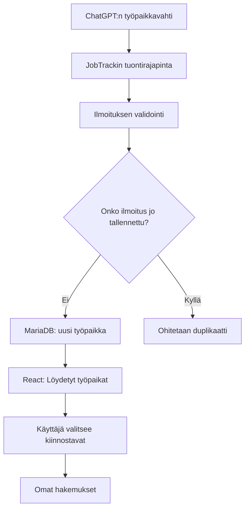
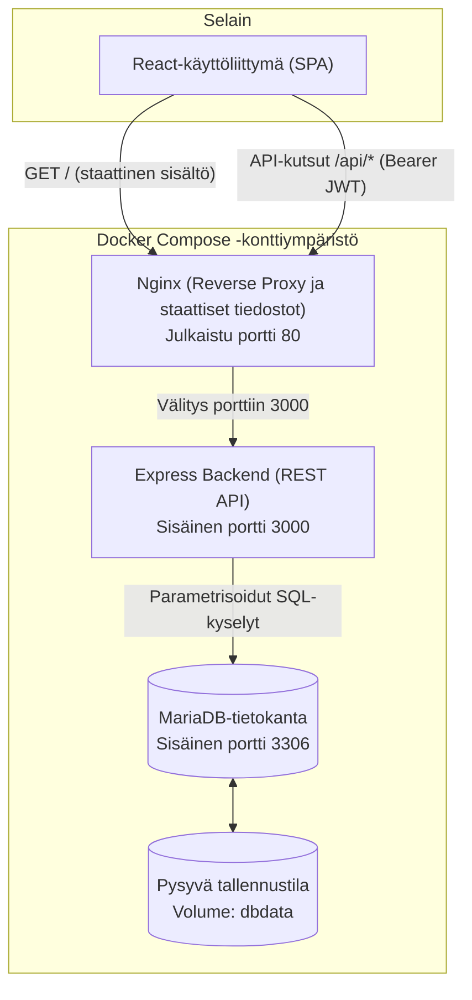
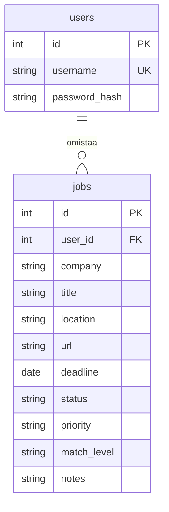

# JobTrack

## Sovelluksen tarkoitus

JobTrack on työnhaun seurantasovellus, jonka toteutan Full Stack Web Development -opintojakson harjoitustyönä. Sovelluksen avulla voin tallentaa kiinnostavia työpaikkoja ja seurata omien hakemusteni etenemistä yhdessä paikassa.

Tavoitteena on oppia rakentamaan kokonainen web-sovellus ja ymmärtää käyttöliittymän, palvelimen ja tietokannan välinen toiminta.

## Toteutetut ominaisuudet

JobTrack on toteutettu täytenä Full Stack -sovelluksena, joka yhdistää React-käyttöliittymän, Express-backendin, MariaDB-tietokannan sekä Docker Compose -kontituksen Nginx-palvelimella. Kaikki toiminnot perustuvat todennettuun käyttäjätiliin ja suojattuun REST API -rajapintaan.

Toteutetut keskeiset toiminnot:
- **Käyttäjähallinta**: Rekisteröityminen, sisäänkirjautuminen ja uloskirjautuminen bcrypt-tiivisteillä ja JWT-autentikoinnilla.
- **Käyttäjäkohtainen CRUD**: Omien työpaikkatietojen lisääminen, listaaminen, katselu, muokkaaminen ja poistaminen.
- **Suodatus ja järjestys**: Työpaikkojen suodatus hakemuksen tilan mukaan sekä järjestäminen prioriteetin tai luontiajan mukaan sekä frontendissä että backendissä.
- **Priorisointi ja arviointi**: Työpaikan tärkeyden valinta (korkea, normaali, matala) ja valinnainen sopivuusluokka oman osaamisen vertailuun.
- **JSON-tuonti**: Työpaikkailmoitusten erätuonti JSON-tiedostosta esikatselulla, tietojen validoinnilla ja kaksoiskappaleiden automaattisella ohituksella.
- **Pysyvä tallennus ja kontitus**: Tiedot säilyvät MariaDB-volumessa, ja koko sovellus käynnistyy yhdellä Docker Compose -komennolla.
- **Automaattinen laadunvalvonta**: Yksikkötestit, MariaDB-integraatiotestit sekä GitLab CI/CD -pipeline.

### Hakujen priorisointi

Prioriteetti kertoo, mihin hakuihin haluan käyttää aikaa ensin. Vaihtoehdot ovat korkea, normaali ja matala. Oletus on normaali, ja listan voi järjestää korkeasta prioriteetista matalaan.

Sopivuusluokka kuvaa omaa arviotani osaamiseni vastaavuudesta tehtävän vaatimuksiin. Vaihtoehdot ovat vahva vastaavuus, osittainen vastaavuus ja stretch. Stretch tarkoittaa tehtävää, joka olisi selvä askel nykyistä osaamistani vaativampaan rooliin. Luokan voi jättää tyhjäksi, jos ilmoitusta ei ole vielä arvioitu.

Prioriteetti, sopivuusluokka ja hakemuksen tila ovat erillisiä tietoja. Esimerkiksi stretch-tehtävällä voi olla korkea prioriteetti ja hakemuksen tilana haastattelu. Osaamisen kehityskohteet kirjataan aluksi muistiinpanoihin.

## Käytetyt teknologiat

- **React** – sovelluksen käyttöliittymä selaimessa.
- **Node.js ja Express** – backend ja REST API, joka käsittelee käyttöliittymän pyynnöt.
- **MariaDB** – käyttäjien ja työpaikkatietojen tallentaminen.
- **Docker Compose** – sovelluksen palvelujen käynnistäminen ja hallinta kontteina.
- **Nginx** – frontendin tiedostojen tarjoaminen selaimelle ja API-pyyntöjen välittäminen backendille.

## JSON-tuonti

Sovellukseen voi tuoda työpaikkoja JSON-tiedostosta. Käytän tätä ChatGPT:ssä toimivan työpaikkavahtini löytämien ilmoitusten siirtämiseen käsin.

Tuontimuoto on JSON-olio, jonka ainoa kenttä on 1–20 työpaikkaa sisältävä `jobs`-taulukko. Työpaikat käyttävät samoja kenttiä kuin tavallinen lisäys, mutta tuonnissa ilmoituksen URL-osoite on pakollinen. Tiedoston enimmäiskoko on 256 KiB. Backendin validointi, esikatselu ja tallennus sekä tuonnin käyttöliittymä on toteutettu. Suora automaattinen yhteys ChatGPT:n ja sovelluksen välillä jää jatkokehitykseen.



Tuonti käyttöliittymässä:

1. Kirjaudu sisään ja valitse JSON-tiedosto kohdassa Tuo työpaikkoja JSON-tiedostosta.
2. Paina Näytä esikatselu. Tässä vaiheessa mitään ei tallenneta.
3. Tarkista työpaikat ja avaa tarvittaessa Näytä työpaikan tiedot nähdäksesi myös muistiinpanot ja muut lisätiedot.
4. Kelvolliset uudet työpaikat ovat valittuina. Poista valinta niistä, joita et halua tuoda. Virheellisiä rivejä ja kaksoiskappaleita ei voi valita.
5. Paina Tallenna valitut. Sovellus ilmoittaa tallennettujen ja ohitettujen työpaikkojen määrät ja päivittää listan nykyisillä suodatusvalinnoilla.

Korjaa virheelliset tiedot alkuperäiseen JSON-tiedostoon ja pyydä uusi esikatselu. Rikkinäinen JSON hylätään ennen esikatselupyyntöä. Jos kaikki rivit ovat virheellisiä tai kaksoiskappaleita, tallennuspainike on pois käytöstä. Tiedosto luetaan selaimessa ja sen sisältö lähetetään rajapinnalle JSONina; alkuperäistä tiedostoa ei tallenneta palvelimen levylle.

## Vaatimusten toteutuminen

Työ perustuu varsinaiseen Full Stack -harjoitustyön tehtävänantoon. Harjoitustehtävä 8 on ollut tukimateriaalia.

| Tehtävänannon vaatimus | Toteutus |
| --- | --- |
| React | Kirjautuminen, työpaikkalomake, listaus ja JSON-tuonti |
| Node.js tai Python | Node.js ja Express |
| MariaDB | Käyttäjät ja heille kuuluvat työpaikat |
| Kirjautuminen | Rekisteröityminen, bcrypt-salasanatiivisteet ja JWT-autentikointi |
| CRUD ja REST API | Käyttäjäkohtainen työpaikkojen lisäys, haku, päivitys ja poisto |
| Dokumentaatio | Tämä README: rakenne, rajapinta, tietomalli, käynnistys ja testaus |
| Testaus | JWT-testit, MariaDB-integraatiotestit, lint, build ja kirjatut selainkokeet |
| GitLab-repositorio | Palautuksessa varmistetaan viimeisimmän version saatavuus ja opettajan oikeudet |
| Esittely | Palautukseen kuuluu lyhyt video; sen tekeminen on erillinen viimeistelyvaihe |

## Arkkitehtuuri

Selain suorittaa React-käyttöliittymän. Käyttöliittymä lähettää `fetch`-pyyntöjä suhteellisiin `/api`-osoitteisiin. Konttikäynnistyksessä Nginx tarjoaa frontendin tiedostot ja välittää API-pyynnöt Expressille. Express tarkistaa autentikoinnin ja syötteet sekä käyttää MariaDB:tä mysql2-yhteyspoolin kautta.



Kehityksessä Vite tarjoaa käyttöliittymän portissa 5173 ja välittää API-pyynnöt paikalliselle Expressille porttiin 3000. Koko sovelluksen konttikäynnistyksessä selaimelle julkaistaan Nginxin portti 80. Kehitysproxy ja Nginx pitävät käyttöliittymän ja API:n selaimen näkökulmasta samassa alkuperässä, joten nykyinen käyttöliittymä ei tarvitse erillistä CORS-konfiguraatiota.

Frontend on yksi React-näkymä ilman erillistä reitityskirjastoa. `App` hallitsee istuntoa, palvelinpyyntöjä ja työpaikkalistaa. Lomake, listaus ja tuonnin esikatselu ovat omia komponenttejaan. Backendissä reitit on jaettu käyttäjätilin, työpaikkojen ja tuonnin mukaan. Validointi ja autentikointi ovat erillisissä moduuleissa. SQL-kyselyt tehdään reittimoduuleissa; erillistä ORM- tai palvelukerrosta ei ole lisätty tähän harjoitustyöhön.

## Tietokanta ja taulujen suhde

Yhdellä käyttäjällä voi olla nolla tai useita työpaikkoja. Jokainen työpaikka kuuluu yhdelle käyttäjälle. Yhteys muodostuu viiteavaimella `jobs.user_id`, joka viittaa kenttään `users.id`.



| Taulu | Keskeiset tiedot ja rajoitteet |
| --- | --- |
| `users` | Automaattinen `id`, yksilöllinen `username` ja `password_hash` |
| `jobs` | Automaattinen `id`, pakollinen omistaja `user_id`, yritys ja tehtävänimike sekä työnhaun tila, prioriteetti ja lisätiedot |

Molemmat taulut käyttävät InnoDB-moottoria ja utf8mb4-merkistöä. Tila, prioriteetti ja sopivuusluokka on rajattu ENUM-arvoihin. `deadline` on DATE-kenttä, jotta siihen ei liity kellonaikaa tai aikavyöhykettä. Puuttuvat valinnaiset tiedot tallennetaan arvona `NULL`.

Viiteavain estää olemattomaan käyttäjään viittaavan työpaikan tallentamisen. Käyttäjää, jolla on työpaikkoja, ei voi poistaa suoraan: automaattista ketjupoistoa ei ole määritelty. Sovelluksessa ei ole käyttäjätilin poistotoimintoa.

Kehityksessä ja koko sovelluksen konttikäynnistyksessä tiedot säilyvät nimetyssä `dbdata`-volumessa. Automaattiset integraatiotestit käyttävät erillistä `jobtrack_test`-kantaa ja väliaikaista testikontin tallennustilaa.

## Tietoturvaratkaisut ja rajaukset

- Salasanat tallennetaan bcrypt-tiivisteinä. Salasanaa tai tiivistettä ei palauteta API-vastauksissa.
- JWT:n allekirjoitus, algoritmi, vanhenemisaika ja käyttäjätunniste tarkistetaan ennen suojattujen reittien käsittelyä. Token säilytetään selaimessa vain Reactin muistissa.
- Omistaja otetaan tarkistetusta tokenista. Työpaikkojen kyselyt rajataan käyttäjään, ja SQL-arvot välitetään parametreina.
- Backend validoi syötteet myös silloin, kun käyttöliittymä on jo tarkistanut niitä. JSON-pyynnöillä on kokorajat.
- Paikalliset salaisuudet ovat Gitin ulkopuolisissa `.env`-tiedostoissa. `.dockerignore` estää ympäristötiedostojen kopioinnin sovelluskuviin.
- Konttikäynnistyksessä vain Nginxin portti julkaistaan koneelle. Backend käyttää sovelluksen tietokantatunnusta ja toimii kontissa ilman root-oikeuksia.

Nykyinen Docker-konfiguraatio on paikallista HTTP-käyttöä varten. HTTPS:ää, kirjautumisyritysten rajoittamista, salasanan palautusta tai JWT-tokenien palvelinpuolista mitätöintiä ei ole toteutettu. Uloskirjautuminen tyhjentää paikallisen istunnon, mutta jo myönnetty token pysyy teknisesti voimassa vanhenemiseensa asti.

## Projektin keskeinen kansiorakenne

```text
backend/
  app.js                      Reitit ja yhteinen virheenkäsittely
  server.js                   HTTP-palvelimen käynnistys
  auth.js                     JWT-tokenit ja autentikointi
  db.js                       MariaDB-yhteyspooli
  check-db.js                 Tietokantayhteyden tarkistus
  schema.sql                  Taulujen luonti
  jobValidation.js            Työpaikkojen ja hakuehtojen validointi
  jobImport.js                Tuonnin validointi ja esikatselutulokset
  routes/                     Käyttäjätilin, työpaikkojen ja tuonnin reitit
  test/                       JWT- ja integraatiotestit
  Dockerfile                  Backendin ajokuva
  .dockerignore               Rakennuksesta pois jätettävät tiedostot
frontend/
  src/
    App.jsx                   Sovelluksen tila ja palvelinpyynnöt
    JobForm.jsx               Lisäys- ja muokkauslomake
    JobList.jsx               Työpaikkataulukko
    JobImport.jsx             Tuontitiedoston valinta ja esikatselu
    jobLabels.js              Yhteiset käyttöliittymätekstit
    api.js                    HTTP-pyyntöjen apufunktio
    index.css                 Tyylit
  vite.config.js              Kehityspalvelin ja API-välitys
  nginx.conf.template         Nginxin tiedostotarjoilu ja API-välitys
  Dockerfile                  Reactin rakennus ja Nginxin ajokuva
  .dockerignore               Rakennuksesta pois jätettävät tiedostot
docker-compose.yml            Koko sovelluksen konttikäynnistys
docker-compose.dev.yml        Kehityksen tietokanta
docker-compose.test.yml       Erillinen testitietokanta
.env.example                  Asetusmalli ilman salaisuuksia
.env.test.example             Testiympäristön asetusmalli
.gitlab-ci.yml                GitLab CI/CD -testipipeline
AGENTS.md                     Koodausavustimen työskentelyohjeet
README.md                     Projektin dokumentaatio
```

## REST API

### Rekisteröityminen

`POST /api/auth/register` vastaanottaa JSON-olion, jossa ovat merkkijonokentät `username` ja `password`. Normalisoidussa käyttäjätunnuksessa sallitaan 3–30 merkkiä joukosta `a–z`, `0–9` ja alaviiva. Salasanan vähimmäispituus on kahdeksan Unicode-koodipistettä ja enimmäispituus 72 UTF-8-tavua. Salasanaa ei normalisoida tai trimmata.

| Status | Merkitys |
| --- | --- |
| `201` | Käyttäjä luotu; vastaus sisältää `id`- ja `username`-kentät |
| `400` | Virheellinen syöte tai rikkinäinen JSON |
| `409` | Käyttäjätunnus on jo käytössä |
| `413` | Pyynnön runko ylittää 16 kilotavun rajan |
| `500` | Odottamaton palvelinvirhe |

Virhevastauksen muoto on `{"error":"Virheen kuvaus"}`. Sisäisiä virhetietoja, salasanoja tai niiden tiivisteitä ei palauteta. Rekisteröityminen luo tilin, mutta ei vielä kirjaa käyttäjää sisään.

### Kirjautuminen ja omat käyttäjätiedot

`POST /api/auth/login` vastaanottaa merkkijonokentät `username` ja `password`. Backend normalisoi käyttäjätunnuksen kuten rekisteröitymisessä ja vertaa salasanaa tallennettuun tiivisteeseen `bcrypt.compare`-funktiolla. Onnistunut vastaus on `200`, ja siinä palautetaan `token` sekä `user`-olio, jonka kentät ovat `id` ja `username`.

Väärä salasana ja tuntematon käyttäjätunnus palauttavat saman `401`-virheen: `Virheellinen tunnus tai salasana.` Tuntemattoman käyttäjän tapauksessa tehdään vertailu valehashiin, jotta puuttuva bcrypt-vertailu ei aiheuta selvää vastausaikaeroa. Virheellinen pyynnön rakenne tai kenttien tietotyyppi palauttaa `400`.

`GET /api/auth/me` edellyttää otsaketta `Authorization: Bearer <token>`. Kelvollisella tokenilla se palauttaa `200` ja käyttäjän `id`- ja `username`-kentät. Puuttuva tai virheellinen token sekä poistettu käyttäjätili johtavat `401`-vastaukseen.

Token allekirjoitetaan HS256-algoritmilla, ja tarkistuksessa hyväksytään vain sama algoritmi. Token sisältää käyttäjätunnisteen `sub`-kentässä sekä myöntämis- ja vanhenemisajan. Tokenin sisältö ei ole salattu. `requireAuth` asettaa tarkistetun käyttäjätunnisteen arvoon `req.user.id`. Työpaikan lisääminen käyttää tätä tunnistetta omistajana, ja listaus rajataan siihen SQL-kyselyssä.

### Työpaikkojen CRUD

Kaikki työpaikkareitit edellyttävät otsaketta `Authorization: Bearer <token>`.

| Metodi ja polku | Toiminta | Onnistunut vastaus |
| --- | --- | --- |
| `POST /api/jobs` | Lisää työpaikan kirjautuneelle käyttäjälle | `201`, tallennettu työpaikka oliona |
| `GET /api/jobs` | Listaa kirjautuneen käyttäjän työpaikat; tukee tila- ja järjestysparametreja | `200`, taulukko työpaikkaolioita |
| `GET /api/jobs/:id` | Hakee yhden oman työpaikan | `200`, työpaikka oliona |
| `PUT /api/jobs/:id` | Korvaa oman työpaikan muokattavat tiedot | `200`, tallennettu työpaikka oliona |
| `DELETE /api/jobs/:id` | Poistaa oman työpaikan | `200`, `{"message":"Työpaikka poistettu."}` |

Työpaikkaolio sisältää kentät `id`, `company`, `title`, `status`, `priority`, `match_level`, `location`, `url`, `deadline` ja `notes`. Hakuaika palautetaan merkkijonona muodossa `YYYY-MM-DD` tai arvona `null`.

Listauksen kyselyparametrit:

| Parametri | Sallitut arvot | Toiminta ilman parametria |
| --- | --- | --- |
| `status` | `interested`, `applied`, `interview`, `offer`, `rejected` | Kaikki oman käyttäjän tilat |
| `sort` | `newest`, `priority` | `newest` |

Järjestys `newest` tarkoittaa suurinta tunnistetta ensin (`id DESC`). Järjestys `priority` palauttaa ensin korkean, sitten normaalin ja lopuksi matalan prioriteetin työpaikat. Saman prioriteetin sisällä järjestys on `id DESC`.

Esimerkiksi `GET /api/jobs?status=applied&sort=priority` palauttaa vain omat lähetetyt hakemukset prioriteettijärjestyksessä. Kelvollinen suodatin, jolla ei löydy työpaikkoja, palauttaa `200` ja tyhjän taulukon. Tuntemattomat parametrit, virheelliset tai tyhjät arvot sekä saman parametrin toistaminen palauttavat `400`.

Kyselyparametrit tarkistetaan `validateJobQuery`-funktiolla. Tila välitetään SQL-kyselyyn parametrina, ja järjestys valitaan palvelinkoodissa määritellyistä SQL-lausekkeista. Käyttäjän tekstiä ei liitetä SQL-rakenteeseen. Omistajuusrajaus säilyy myös suodatetuissa ja järjestetyissä listauksissa.

Polun `:id` tarkistetaan yhteisessä `router.param`-käsittelijässä. Sallittu muoto on positiivinen kokonaisluku välillä 1–4294967295 ilman etunollia. Virheellinen tunniste palauttaa `400` ennen tietokantakyselyä.

Yksittäisen työpaikan haku, päivitys ja poisto rajataan SQL-ehdolla `WHERE id = ? AND user_id = ?`. Puuttuva työpaikka ja toisen käyttäjän työpaikka palauttavat saman `404`-vastauksen `{"error":"Työpaikkaa ei löytynyt."}`. Päivityksessä pyynnön sisältö validoidaan ensin, joten virheellinen syöte palauttaa `400`.

`PUT` korvaa kaikki muokattavat tiedot ja käyttää samaa validointia kuin lisääminen. Yritys ja tehtävänimike ovat pakollisia. Pois jätetyt valinnaiset kentät palautuvat alla kuvattuihin oletusarvoihinsa. Tunniste ja omistaja säilyvät ennallaan. Myös saman päivityksen toistaminen muuttumattomilla arvoilla palauttaa `200`.

Lisäyspyynnön esimerkki:

```json
{
  "company": "Esimerkki Oy",
  "title": "Ohjelmistokehittäjä",
  "status": "applied",
  "priority": "high",
  "match_level": "stretch",
  "location": "Helsinki / etä",
  "url": "https://example.com/jobs/123",
  "deadline": "2028-02-29",
  "notes": "Kysy etätyömahdollisuudesta."
}
```

Kentät `company` ja `title` ovat pakollisia merkkijonoja. Niiden reunoilta poistetaan välilyönnit, minkä jälkeen pituuden on oltava 1–100 Unicode-koodipistettä. Kirjainkoko säilytetään.

| Valinnainen kenttä | Sallitut arvot | Oletusarvo kentän puuttuessa |
| --- | --- | --- |
| `status` | `interested`, `applied`, `interview`, `offer`, `rejected` | `interested` |
| `priority` | `high`, `normal`, `low` | `normal` |
| `match_level` | `strong`, `partial`, `stretch` tai JSON-arvo `null` | `null` |

Oletusarvo asetetaan vain puuttuvalle kentälle. Kentät `status` ja `priority` eivät hyväksy arvoa `null`. Sopivuusluokan `null` tarkoittaa, ettei sopivuutta ole arvioitu. Valintojen merkkijonoarvot hyväksytään täsmälleen taulukon muodossa. Virheelliset arvot hylätään `400`-vastauksella ennen tietokantaan kirjoittamista.

Lisätietojen säännöt:

| Valinnainen kenttä | Sääntö |
| --- | --- |
| `location` | Merkkijono, enintään 150 Unicode-koodipistettä |
| `url` | Merkkijono, enintään 2048 Unicode-koodipistettä; alkaa `http://` tai `https://` ja läpäisee URL-jäsennyksen |
| `deadline` | Todellinen päivämäärä muodossa `YYYY-MM-DD`, vuosi 1000–9999; myös mennyt päivämäärä sallitaan |
| `notes` | Merkkijono, enintään 2000 Unicode-koodipistettä; sovelluksen oma pituusraja |

Näissä neljässä lisätietokentässä puuttuva arvo, JSON-arvo `null`, tyhjä merkkijono ja pelkät välilyönnit tallennetaan arvona `null`. Tekstin reunoilta poistetaan välilyönnit ennen pituustarkistusta, mutta sisäiset välilyönnit ja rivinvaihdot säilytetään. Muita tietotyyppejä ei muuteta automaattisesti tekstiksi.

URL-tarkistus ei tee verkkopyyntöä eikä varmista ilmoituksen olemassaoloa. Päivämäärän tarkistus hylkää mahdottomat päivät, kuten `2026-02-30`, ja hyväksyy kelvollisen karkauspäivän. Listauksen SQL-kysely käyttää `DATE_FORMAT`-funktiota, jotta hakuaika palautuu päivämäärätekstinä ilman aikavyöhykemuunnosta.

Tuntemattomat kentät, myös asiakkaan lähettämät `id` ja `user_id`, hylätään `400`-vastauksella.

Työpaikan omistaja otetaan aina tarkistetusta tokenista. Listauksen parametrisoitu SQL-kysely rajaa rivit ehdolla `WHERE user_id = ?`. Käyttäjä, jolla ei ole työpaikkoja, saa vastaukseksi tyhjän taulukon `[]`.

Virheellinen lisäyssyöte palauttaa `400`. Puuttuva tai virheellinen token johtaa `401`-vastaukseen. Sovelluksen yhteinen virheenkäsittely palauttaa rikkinäisestä JSON:sta `400`, liian suuresta pyynnöstä `413` ja odottamattomasta palvelinvirheestä `500`.

### JSON-tuonnin esikatselu

`POST /api/job-import/preview` vaatii Bearer-tokenin ja vastaanottaa JSON-sisällön, esimerkiksi:

```json
{
  "jobs": [
    {
      "company": "Esimerkki Oy",
      "title": "Kehittäjä",
      "url": "https://example.com/jobs/developer"
    }
  ]
}
```

`backend/jobImport.js` käyttää nykyistä `validateJob`-funktiota ja tarkistaa lisäksi tuonnin rakenteen, työpaikkamäärän ja pakollisen URL-osoitteen. `backend/routes/jobImportRoutes.js` hakee mahdolliset kaksoiskappaleet vain kirjautuneen käyttäjän työpaikoista. Esikatselu ei tallenna tai muuta työpaikkoja.

Onnistunut vastaus sisältää `summary`-olion (`total`, `ready`, `invalid`, `duplicate`) ja `rows`-taulukon. Jokaisella rivillä on tiedoston järjestystä vastaava rivinumero `row`, tulos `status`, selite `message` sekä normalisoitu `job` tai virheellisellä rivillä `null`.

| Rivin tulos | Merkitys |
| --- | --- |
| `ready` | Tiedot ovat kelvolliset eikä samaa URL-osoitetta löytynyt |
| `invalid` | Työpaikan tiedoissa on virhe tai URL puuttuu |
| `duplicate` | Sama URL on jo käyttäjän työpaikoissa tai tiedoston aiemmalla kelvollisella rivillä |

URL-osoitteita verrataan täsmälleen merkkijonoina reunoilta poistettujen välilyöntien jälkeen. Eri osoitteissa julkaistua samaa työpaikkaa ei tunnisteta automaattisesti samaksi ilmoitukseksi. Toisen käyttäjän työpaikat eivät vaikuta tulokseen.

Kelvollinen esikatselupyyntö palauttaa `200`, vaikka yksittäisillä riveillä olisi virheitä. Virheellinen rakenne, tyhjä taulukko tai yli 20 työpaikkaa palauttaa `400`. Ilman kelvollista tokenia vastaus on `401`. Tuontireitin JSON-raja on 256 KiB, ja sen ylitys palauttaa `413`; tavallisten reittien 16 KiB:n raja säilyy. Tuontireitit liitetään sovellukseen ennen yleistä JSON-käsittelijää, ja niiden autentikointi suoritetaan ennen tuontisisällön lukemista.

### JSON-tuonnin tallennus

`POST /api/job-import/save` vastaanottaa valitut työpaikat samassa `{"jobs":[...]}`-muodossa kuin esikatselu ja vaatii Bearer-tokenin. Backend tarkistaa tiedot uudelleen. Jos yksikin valittu rivi on virheellinen, vastaus on `400`, eikä mitään tallenneta. Vastauksen `rows` sisältää virheellisten rivien numerot ja selitteet. Numerot viittaavat tallennuspyynnön järjestykseen.

Tallennus käyttää yhtä tietokantayhteyttä ja transaktiota. Käyttäjän rivi lukitaan komennolla `SELECT ... FOR UPDATE` ennen URL-hakua, joten saman käyttäjän samanaikaiset tuonnit käsitellään vuorotellen. Kaksoiskappaleet tarkistetaan uudelleen tallennushetkellä ja ohitetaan muuttamatta vanhoja työpaikkoja. Tietokantavirheessä transaktion kirjoitukset perutaan. Tämä toistojen esto koskee JSON-tuontia; tavallinen lisäyslomake ei estä saman URL-osoitteen tallentamista.

Onnistunut vastaus sisältää `summary`-olion (`total`, `imported`, `duplicate`) ja `rows`-taulukon. Tallennetun rivin tulos on `imported`, ja sen `job` sisältää luodun tunnisteen. Ohitetun rivin tulos on `duplicate`.

| Status | Merkitys |
| --- | --- |
| `201` | Vähintään yksi uusi työpaikka tallennettiin |
| `200` | Kaikki rivit olivat kaksoiskappaleita; mitään ei muutettu |
| `400` | Virheellinen rakenne tai työpaikkatiedot |
| `401` | Kelvollinen kirjautuminen puuttuu tai käyttäjätiliä ei enää ole |
| `413` | Tuontipyynnön 256 KiB:n kokoraja ylittyy |
| `500` | Odottamaton palvelinvirhe |

## Kehityksen ympäristöasetukset

Compose ja backendin npm-käynnistyskomennot lukevat ympäristökohtaiset arvot repon juuressa olevasta `.env`-tiedostosta. Uudessa asennuksessa kopioi `.env.example` tiedostoksi `.env`, täytä tietokantasalasanat ja luo JWT-allekirjoitusavain. Säilytä olemassa olevan `.env`-tiedoston arvot.

| Muuttuja | Tarkoitus | Malliarvo |
| --- | --- | --- |
| `MARIADB_VERSION` | MariaDB-kuvan versio | `11.8` |
| `DB_NAME` | Sovelluksen tietokanta | `jobtrack` |
| `DB_USER` | Sovelluksen tietokantakäyttäjä | `appuser` |
| `DB_HOST` | Kehityksen portin sidontaosoite ja paikallisen Noden tietokantapalvelin | `127.0.0.1` |
| `DB_PORT` | Kehityskoneelle julkaistu portti, jota paikallinen Node käyttää | `3306` |
| `DB_ROOT_PASSWORD` | Ylläpitäjän salasana | Täytetään vain `.env`:iin |
| `DB_PASSWORD` | Sovelluksen tietokantakäyttäjän salasana | Täytetään vain `.env`:iin |
| `JWT_SECRET` | Satunnainen 32 tavun allekirjoitusavain 64 heksadesimaalimerkkinä | Luodaan vain paikalliseen `.env`:iin |
| `JWT_TTL_SECONDS` | Tokenin voimassaoloaika sekunteina | `3600` |

JWT-avain luodaan kryptografisesti turvallisella satunnaisgeneraattorilla. Backend tarkistaa avaimen muodon ja voimassaoloajan käynnistyksessä. `.env`-muutosten jälkeen backend on käynnistettävä uudelleen, jotta uudet arvot latautuvat.

Pidä kehityksen `DB_HOST` arvossa `127.0.0.1`, jotta portti on käytettävissä vain omalla koneella. Kontin sisäinen MariaDB-portti on 3306. Tietokannan tiedot tallennetaan nimettyyn `dbdata`-volumeen.

Tarkista asetukset tulostamatta niiden sisältöä:

```sh
docker compose -f docker-compose.dev.yml config --quiet
```

`.env` ei kuulu versionhallintaan. Tietokannan ja käyttäjien alustusarvot otetaan käyttöön vain tyhjän tietokannan ensimmäisellä käynnistyksellä; niiden muuttaminen `.env`:ssä ei muuta olemassa olevaa tietokantaa tai sen salasanoja.

Käynnistä tietokanta repon juuressa:

```sh
docker compose -f docker-compose.dev.yml up -d
docker compose -f docker-compose.dev.yml ps
```

Odota, että tietokannan tila on `healthy`. Uudessa tietokannassa taulut on luotava erikseen tiedoston `backend/schema.sql` avulla; nykyinen Compose-asetus ei suorita tiedostoa automaattisesti.

## Backendin käynnistäminen kehityksessä

Kehityksessä käytetään Node.js 24:ää ja npm:ää. Asenna riippuvuudet ensimmäisellä käyttökerralla repon juuresta seuraavasti:

```sh
cd backend
npm install
```

Käynnistä backend samassa hakemistossa:

```sh
npm run dev
```

Käynnistyskomento lataa repon juuren `.env`-tiedoston. Rekisteröityminen edellyttää käynnissä olevaa tietokantaa ja luotua `users`-taulua. Palvelin kuuntelee osoitteessa `http://localhost:3000`. Kehitystila käynnistää palvelimen uudelleen koodin muuttuessa. Palvelimen voi pysäyttää näppäinyhdistelmällä Ctrl+C.

## Frontendin käynnistäminen kehityksessä

Frontendin npm-komennot ajetaan `frontend/`-hakemistossa. Asenna riippuvuudet ensimmäisellä käyttökerralla repon juuresta:

```sh
cd frontend
npm install
```

Luo ensimmäisellä käyttökerralla `frontend/.env` tiedoston `frontend/.env.example` pohjalta. Säilytä olemassa oleva asetustiedosto. Kehityspalvelimen asetus on:

```dotenv
API_PROXY_TARGET=http://127.0.0.1:3000
```

Frontendin ympäristötiedosto sisältää vain kehityksen API-välityksen osoitteen. Tietokantasalasanat ja JWT-allekirjoitusavain kuuluvat backendin asetuksiin repon juuren `.env`-tiedostossa. Frontendin paikallinen `.env` on suljettu pois versionhallinnasta.

Pidä kehitystietokanta ja backend käynnissä. Käynnistä frontend omassa terminaalissaan `frontend/`-hakemistossa:

```sh
npm run dev
```

Avaa `http://localhost:5173`. Vite käyttää kiinteää porttia 5173 ja ilmoittaa virheestä, jos portti on varattu. Selain käyttää suhteellisia `/api`-osoitteita, ja Viten kehitysproxy välittää pyynnöt Expressille. Koko sovelluksen konttikäynnistyksessä API-välityksen toteuttaa Nginx.

### Frontendin rakenne ja istunto

- `src/App.jsx` hallitsee kirjautumis- ja rekisteröitymislomaketta, istuntoa, työpaikkalistaa, muokattavaa työpaikkaa, palvelinpyyntöjä sekä lataus- ja ilmoitustiloja.
- `src/JobForm.jsx` sisältää yhteisen lisäys- ja muokkauslomakkeen. Epäonnistunut tallennus säilyttää syötteet korjaamista varten, jos istunto on edelleen voimassa.
- `src/JobImport.jsx` näyttää tiedoston valinnan, esikatselun ja rivivalinnat. `App.jsx` lukee tiedoston, tekee tuontipyynnöt ja päivittää työpaikkalistan. Uloskirjautuminen poistaa tuonnin esikatselun ja valinnat näkymän mukana.
- `src/JobList.jsx` näyttää yrityksen, tehtävän, tilan, prioriteetin, sopivuuden ja hakuajan sekä muokkaus- ja poistopainikkeet. Arvioimaton sopivuus näkyy tekstinä Ei arvioitu. Ilmoituksen URL näkyy tehtävänimikkeen linkkinä.
- `src/jobLabels.js` sisältää hakemuksen tilan, prioriteetin ja sopivuusluokan yhteiset käyttöliittymätekstit.
- `src/api.js` tekee fetch-kutsut, lisää Bearer-tokenin ja välittää virheilmoitukset käyttöliittymään. Pyyntöjen aikaraja on 10 sekuntia.
- `src/index.css` sisältää käyttöliittymän tyylit.
- `vite.config.js` määrittelee React-lisäosan ja kehityksen API-välityksen.

Kirjautumisnäkymän Luo käyttäjätili -painikkeella voi vaihtaa rekisteröitymiseen. Backend validoi tunnuksen ja salasanan, ja käyttöliittymä näyttää mahdolliset virheilmoitukset. Onnistunut rekisteröityminen palauttaa kirjautumislomakkeelle ja näyttää vahvistuksen. Kirjautuminen tehdään erikseen. Lomaketilan vaihtaminen tyhjentää syötteet ja vanhat ilmoitukset.

Kirjautumisen jälkeen sovellus hakee käyttäjän työpaikat ja näyttää työpaikkanäkymän. Token säilytetään vain Reactin muistissa, joten sivun uudelleenlataus palauttaa kirjautumisnäkymän. Uloskirjautuminen poistaa paikallisen tokenin, työpaikkatiedot ja muokkaustilan; se ei mitätöi jo myönnettyä tokenia palvelimella. Työpaikkapyynnön palauttama `401` tyhjentää myös istunnon, työpaikat ja muokkaustilan.

Uusi työpaikka lisätään lomakkeella. Muokkaa-painike avaa valitun työpaikan tiedot samaan lomakkeeseen, ja Peruuta muokkaus palauttaa lisäystilaan tallentamatta muutoksia. Tallennuksen jälkeen lista haetaan uudelleen nykyisillä suodatus- ja järjestysvalinnoilla. Jos tallennus onnistuu mutta listan haku epäonnistuu, käyttöliittymä ilmoittaa molemmista erikseen. Poisto vaatii vahvistuksen, ja rivi poistuu listalta vasta onnistuneen palvelinpyynnön jälkeen.

Hakemuksen tila -valinta rajaa listaa backendin `status`-kyselyparametrilla. Kaikki tilat jättää parametrin pois. Järjestys-valinta käyttää `sort=newest`- tai `sort=priority`-parametria. Prioriteettijärjestys on korkea, normaali ja matala; saman prioriteetin sisällä uusin tunniste tulee ensin. Otsikon lukumäärä kertoo nykyisen hakutuloksen koon. Päivitä lista säilyttää valinnat, ja uusi kirjautuminen palauttaa oletukset Kaikki tilat ja Uusimmat ensin.

## Koko sovelluksen käynnistäminen Dockerilla

Käynnistys edellyttää Dockeria, Docker Composea ja täytettyä juuren `.env`-tiedostoa. Backendin ja frontendin riippuvuudet asennetaan Docker-kuvien rakennuksessa `npm ci` -komennolla. Paikallista Node-asennusta ei tarvita tähän käynnistystapaan.

Lisää tietokanta- ja JWT-asetusten lisäksi `.env.example`-tiedostossa kuvatut konttiasetukset:

| Muuttuja | Tarkoitus | Malliarvo |
| --- | --- | --- |
| `NODE_IMAGE` | Backendin ajokuva ja frontendin rakennuskuva | `node:24-bookworm-slim` |
| `NGINX_IMAGE` | Frontendin ajokuva | `nginx:stable-alpine` |
| `DB_CONTAINER_HOST` | Tietokannan palvelunimi Compose-verkossa | `db` |
| `DB_CONTAINER_PORT` | Tietokannan sisäinen portti | `3306` |
| `API_UPSTREAM` | Nginxin käyttämä backend-osoite ilman loppukauttaviivaa | `http://backend:3000` |
| `WEB_HOST` | Julkaistavan HTTP-portin sidontaosoite | `127.0.0.1` |
| `WEB_PORT` | Sovelluksen HTTP-portti omalla koneella | `80` |

Backend-kontin `DB_HOST` ja `DB_PORT` saavat arvonsa `DB_CONTAINER_HOST`- ja `DB_CONTAINER_PORT`-asetuksista. Kehityksen paikalliselle Nodelle tarkoitetut `DB_HOST`- ja `DB_PORT`-arvot säilyvät juuren `.env`:ssä ennallaan. Vain frontendin HTTP-portti julkaistaan omalle koneelle; backend ja tietokanta ovat käytettävissä Compose-verkon sisällä.

Tiedostojen tehtävät:

- `docker-compose.yml` määrittelee kolme palvelua, ympäristömuuttujat, terveystarkistukset ja käynnistysjärjestyksen.
- `backend/Dockerfile` asentaa ajonaikaiset riippuvuudet ja käynnistää `node server.js` -prosessin ilman root-oikeuksia.
- `frontend/Dockerfile` rakentaa Reactin Node-vaiheessa ja kopioi valmiit tiedostot Nginx-kuvaan.
- `frontend/nginx.conf.template` määrittelee staattiset tiedostot ja API-välityksen. Nginxin käynnistysskripti täyttää `API_UPSTREAM`-arvon ympäristöstä.
- Molempien sovellushakemistojen `.dockerignore` sulkee paikalliset ympäristötiedostot, riippuvuudet ja lokit pois rakennuskontekstista.

Kun vaihdat paikallisesta kehityksestä koko sovelluksen konttikäynnistykseen, pysäytä paikallinen backend ja Vite näppäinyhdistelmällä Ctrl+C. Aja sitten projektin juuressa:

```sh
docker compose config --quiet
docker compose -f docker-compose.dev.yml stop
docker compose up -d --build --wait
```

Avaa `http://localhost`. `--wait` odottaa palvelujen terveystarkistusten onnistumista. Ensimmäinen käynnistys voi kestää kuvien lataamisen ja riippuvuuksien asentamisen vuoksi. Myöhemmät lähdekoodimuutokset otetaan käyttöön samalla `docker compose up -d --build --wait` -komennolla.

Kehityksen ja koko sovelluksen Compose-asetukset käyttävät samaa `dbdata`-volumea, kun ne ajetaan samalla Compose-projektin nimellä. Tietokannan tiedot säilyvät kontteja vaihdettaessa. Uudessa tyhjässä kannassa `backend/schema.sql` suoritetaan automaattisesti alustuksessa. Se ei päivitä olemassa olevan kannan taulurakennetta.

Pysäytä koko sovellus tietoja poistamatta komennolla `docker compose stop`. Kun palaat paikalliseen kehitykseen, pysäytä ensin koko sovellus, käynnistä tietokanta komennolla `docker compose -f docker-compose.dev.yml up -d --wait` ja käynnistä backend sekä Vite omissa terminaaleissaan aiempien ohjeiden mukaan.

### Konttikäynnistyksen tarkistukset

Aja projektin juuressa:

```sh
docker compose ps
docker compose exec backend node check-db.js
docker compose exec frontend nginx -t
curl -i http://localhost/api/health
```

Opiskelijan toimittamassa ajossa 11.10.2026 molemmat sovelluskuvat rakennettiin ja kaikki kolme palvelua olivat `healthy`. Tietokantatarkistus löysi `users`- ja `jobs`-taulut, Nginxin asetustarkistus onnistui ja Nginxin kautta tehty health-pyyntö palautti `200` sekä `{"status":"ok"}`. Opiskelija vahvisti myös sovelluksen toimivan selaimessa konttikäynnistyksellä.

Rakennus tuotti kaksi varoitustyyppiä: Bake-rakennustavan tarvitsema Buildx puuttui, ja `InvalidDefaultArgInFrom` ilmoitti Dockerfilejen pohjakuvamuuttujien puuttuvista oletusarvoista. Compose välitti vaaditut kuva-arvot `.env`:stä, ja rakennus valmistui varoituksista huolimatta. Dockerfilet edellyttävät tällä hetkellä pohjakuvien antamista rakennusargumentteina.

## Testaus

### Frontendin tarkistukset

Aja `frontend/`-hakemistossa:

```sh
npm run lint
npm run build
```

Nykyinen Vite-pohja käyttää linttaukseen Oxlintia. Opiskelijan paikallisessa ajossa 11.10.2026 tarkistus valmistui ilman varoituksia tai virheitä. Tuotantoversion koostaminen onnistui Vitellä 8.3.4 ja loi `frontend/dist/`-hakemiston. Myös Viten kehityspalvelin käynnistyi onnistuneesti.

Opiskelija vahvisti kirjautumisen onnistuvan selaimessa. Lisäksi seuraavat käyttöliittymän käsintestit vahvistettiin onnistuneiksi 11.10.2026:

- Työpaikan lisääminen ja tietojen säilyminen listan päivityksen jälkeen.
- Tehtävänimikkeen ja prioriteetin muokkaaminen sekä muutosten säilyminen listan päivityksen jälkeen.
- Muokkauksen peruuttaminen tallennettuja tietoja muuttamatta.
- Pelkistä välilyönneistä koostuvan yritysnimen hylkääminen: virheilmoitus näkyy ja syötteet säilyvät lomakkeella.
- Poiston peruuttaminen ja testityöpaikan poistaminen vahvistuksen jälkeen.
- Liian lyhyen salasanan virheilmoitus rekisteröitymisessä.
- Uuden käyttäjän rekisteröityminen, vahvistusviesti ja paluu kirjautumislomakkeelle.
- Uudella tunnuksella kirjautuminen ja tyhjä työpaikkalista.
- Uloskirjautuminen ja saman tunnuksen uuden rekisteröintiyrityksen hylkääminen.
- Syötteiden ja vanhojen ilmoitusten tyhjentyminen kirjautumis- ja rekisteröitymistilan välillä vaihdettaessa.
- Tilasuodatus ja paluu kaikkien tilojen listaukseen.
- Prioriteettijärjestys: korkea, normaali ja matala.
- Lisäyksen ja muokkauksen vaikutus listaan nykyisen suodatuksen ja järjestyksen mukaisesti.
- Valintojen säilyminen listan päivityksessä ja palautuminen oletuksiin uudessa kirjautumisessa.
- Sopivuusluokan näyttäminen työpaikkataulukossa.
- JSON-tuonnissa valittujen työpaikkojen tallentaminen.
- Jo tuotujen työpaikkojen tunnistaminen kaksoiskappaleiksi uudessa esikatselussa.
- Rikkinäisen JSON-tiedoston virheilmoitus.
- Kolmen virheellisen tuontirivin hylkääminen: puuttuva URL, tyhjä yrityksen nimi ja mahdoton päivämäärä. Tallennuspainike pysyy pois käytöstä.

Väärän salasanan virheilmoituksen ja sivun uudelleenlatauksen käsintestien tulokset odottavat vielä vahvistusta. Lint- ja build-tarkistukset eivät yksin varmista käyttöliittymän toimintaa. Frontendin automaattisia toimintatestejä ei ole vielä toteutettu.

### Tietokantayhteyden tarkistus

Kun tietokanta on käynnissä ja taulut on luotu, aja `backend/`-hakemistossa:

```sh
npm run db:check
```

Komento lataa repon juuren `.env`-tiedoston ja suorittaa `check-db.js`-tarkistuksen. Odotettu tulos on `Tietokantayhteys toimii. users- ja jobs-taulut löytyvät.` Virhetilanteessa komento palauttaa poistumiskoodin 1. Tarkistus sulkee lopuksi oman yhteyspoolinsa eikä muuta tietokannan sisältöä.

### API:n toimintatarkistus

Backendin perusvaste voidaan tarkistaa curlilla palvelimen ollessa käynnissä:

```sh
curl -i http://localhost:3000/api/health
```

Odotettu HTTP-status on `200 OK` ja vastaus `{"status":"ok"}`. Kaikki rekisteröitymisen, kirjautumisen ja suojattujen reittien toiminnot sekä virhetilanteet on automatisoitu alla kuvattuihin testi-tiedostoihin.

### Automaattiset autentikointitestit

Autentikointimoduulin (`backend/auth.js`) ja `requireAuth`-middlewaren toiminta varmistetaan automaattisilla testeillä tiedostossa `backend/test/auth.test.js`. Testit käyttävät Node.js:n sisäänrakennettua testityökalua (`node:test` ja `node:assert/strict`), joten erillisiä ulkoisia testikirjastoja ei tarvita.

Aja testit `backend/`-hakemistossa:

```sh
npm test
```

Komento suorittaa skriptin `node --test test/*.test.js`. Testit käynnistävät erillisen Express-testipalvelimen satunnaiseen vapaaseen porttiin ja käyttävät testiajoa varten luotua satunnaista JWT-avainta, joten ne ovat riippumattomia tietokannasta ja paikallisesta `.env`-tiedostosta. Tietokantaa käyttävät integraatiotestit ajetaan omalla komennollaan.

Opiskelijan paikallisessa testiajossa 10.10.2026 kaikki yhdeksän testiä läpäistiin (9 läpäistyä, 0 epäonnistunutta).

Testisarja kattaa seuraavat tapaukset:

| Testitapaus | Varmistettava asia |
| --- | --- |
| Tokenin luonti (`createToken`) | Token sisältää käyttäjätunnisteen (`sub`), voimassaoloajan (`exp`), myöntämisajan (`iat`) ja HS256-algoritmin eikä ylimääräisiä kenttiä |
| Kelvollinen token | Päästää suojatulle reitille (`200 OK`) ja asettaa tarkistetun käyttäjän tunnisteen arvoon `req.user` |
| Puuttuva token | Estää pääsyn (`401 Unauthorized`, viesti `Kirjautuminen vaaditaan.`) |
| Rikkinäinen / virheellinen token | Hylätään (`401 Unauthorized`) |
| Vanhentunut token | Hylätään automaattisesti (`401 Unauthorized`) |
| Väärällä avaimella allekirjoitettu token | Hylätään allekirjoitusvirheenä (`401 Unauthorized`) |
| Väärällä algoritmilla luotu token | Hylätään algoritmitarkistuksessa (`401 Unauthorized`) |
| Token ilman vanhenemisaikaa | Hylätään (`401 Unauthorized`) |
| Token, jossa virheellinen käyttäjä-id (ei numero) | Hylätään (`401 Unauthorized`) |

### Autentikoinnin integraatiotesti

Tiedosto `backend/test/authRoutes.integration.js` testaa oikean Express-sovelluksen ja MariaDB:n yhteistoimintaa. Testi käy läpi yhden käyttäjän rekisteröitymisen, kirjautumisen ja omien tietojen haun sekä niihin liittyviä virhetilanteita.

Kopioi ensimmäisellä käyttökerralla repon juuren `.env.test.example` tiedostoksi `.env.test`. Luo siihen erilliset satunnaiset arvot kenttiin `DB_ROOT_PASSWORD`, `DB_PASSWORD` ja `JWT_SECRET`. JWT-avain on 32 satunnaista tavua 64 heksadesimaalimerkkinä. Säilytä olemassa olevan `.env.test`-tiedoston arvot. Paikallinen tiedosto on suljettu pois Gitistä, mutta salaisuuksia sisältämätön esimerkkitiedosto kuuluu versionhallintaan.

Testiasetuksissa `NODE_ENV=test`, `DB_NAME=jobtrack_test` ja `DB_USER=jobtrack_test`. Testikanta käyttää osoitetta `127.0.0.1:3307`, kun kehityskanta käyttää porttia 3306. Testi tarkistaa ympäristöasetukset ennen sovelluksen lataamista ja tietokannan nimen ennen testidatan kirjoittamista.

Käynnistä testitietokanta repon juuressa:

```sh
docker compose --env-file .env.test -f docker-compose.test.yml config --quiet
docker compose --env-file .env.test -f docker-compose.test.yml up -d --wait
```

Compose-projektin nimi on `jobtrack-tests`. Testikontti luo taulut tiedostosta `backend/schema.sql` alustuksen yhteydessä. Tietokannan tiedostot ovat väliaikaisessa `tmpfs`-liitoksessa, joten testidata häviää kontin pysähtyessä. Kehitystietokannan `dbdata`-volumea ei käytetä.

Aja yhteyden tarkistus ja integraatiotestit repon juuresta:

```sh
cd backend
node --env-file=../.env.test check-db.js
npm run test:integration
```

Testikontin on oltava käynnissä. Erillistä `npm run dev` -palvelinta ei tarvita, sillä testi käynnistää sovelluksen vapaaseen paikalliseen porttiin. Testi luo satunnaisen käyttäjätunnuksen ja poistaa lopuksi vain kyseisen tunnuksen sekä sulkee palvelimen ja tietokantayhteyspoolin.

| Tarkistus | Odotettu tulos |
| --- | --- |
| Rekisteröityminen | `201`, positiivinen kokonaisluku-id ja normalisoitu käyttäjätunnus ilman salasanakenttiä |
| Tallennettu salasana | Tietokannassa on alkuperäisestä salasanasta poikkeava tiiviste, jonka bcrypt-vertailu onnistuu |
| Saman tunnuksen rekisteröinti uudelleen | `409` |
| Kirjautuminen | `200`, token ja käyttäjän julkiset tiedot; tunnus normalisoidaan kuten rekisteröitymisessä |
| Omien tietojen haku tokenilla | `200`, rekisteröidyn käyttäjän julkiset tiedot |
| Omien tietojen haku ilman tokenia | `401` |
| Väärä salasana ja tuntematon käyttäjä | Molemmista `401` ja sama virheviesti |

### Työpaikkojen integraatiotesti

Tiedosto `backend/test/jobs.integration.js` ajetaan samalla `npm run test:integration` -komennolla ja samalla testitietokannalla kuin autentikoinnin integraatiotesti. Se luo kaksi omaa testikäyttäjää ja varmistaa automatisoidusti seuraavat kokonaisuudet:

| Testattu osa-alue | Varmistetut säännöt ja todennetut tulokset |
| --- | --- |
| **Käyttäjien eristys (IDOR-suojaus)** | Toisen käyttäjän työpaikan haku, muokkaus tai poisto palauttaa aina `404 Not Found` eikä paljasta tietueen olemassaoloa. Käyttäjäkohtainen listaus palauttaa täsmälleen vain omat työpaikat, ja toisen käyttäjän tiedot säilyvät koskemattomina. |
| **CRUD-perustoiminnot** | Työpaikan luominen (`201 Created`), omien ilmoitusten listaus (`200 OK`), yksittäisen ilmoituksen haku (`200 OK`), muokkaaminen (`200 OK`) ja poistaminen (`200 OK`). Poistetun tietueen uusi haku tai poisto palauttaa `404`. |
| **Pakollisten kenttien validointi** | Puuttuvat, tyhjät tai yli 100 merkin yrityksen ja tehtävänimikkeen arvot hylätään (`400 Bad Request`). Numeeriset tai virheelliset tila-, prioriteetti- ja sopivuusluokat hylätään (`400`). Reunoilta trimmataan välilyönnit ennen tallennusta. |
| **Lisätietojen tyypit ja rajat** | Sijainnin (max 150), URL-osoitteen (max 2048) ja muistiinpanojen pituus- ja tyyppirajat. Virheelliset URL-muodot (kuten `javascript:`) hylätään (`400`). Päivämäärät vaativat muodon `VVVV-KK-PP` ja kalenterinmukaisen kelvollisuuden (karkauspäivä `2028-02-29` hyväksytään, mahdottomat päivät hylätään `400`). |
| **Tila- ja prioriteettisuodatus** | Suodatus tilan perusteella (`?status=offer`) palauttaa vain oman käyttäjän kyseisen tilan ilmoitukset. Järjestäminen (`?sort=priority`) asettaa ilmoitukset järjestykseen korkea, normaali ja matala. Tuntemattomat tai toistetut kyselyparametrit hylätään (`400`). |
| **JSON-tuonnin esikatselu** | Tiedoston rakenne ja enintään 20 työpaikan taulukko validoidaan (max 256 KiB). Tunnistaa ennestään tietokannassa olevat URL-osoitteet kaksoiskappaleiksi ja palauttaa rivikohtaiset tilat (`new`, `duplicate`, `invalid`). |
| **JSON-tuonnin atominen tallennus** | Vain valitut kelvolliset rivit tallennetaan (`201 Created`), kaksoiskappaleet ohitetaan, ja virheelliset rivit estävät koko erän tallennuksen (`400`). Rinnakkaiset samanaikaiset tuonnit estetään duplikaattisuojauksella. |
| **Autentikoinnin vaatimus** | Kaikki työpaikkareitit, suodatukset ja tuontikutsut ilman tokenia palauttavat `401 Unauthorized`. |

Testi käyttää satunnaisia käyttäjätunnuksia. Siivouksessa poistetaan vain testin omat työpaikat ja käyttäjät. Työpaikat poistetaan ennen käyttäjiä tietokannan viiteavaimen vuoksi.

Opiskelijan paikallisissa testiajoissa 11.10.2026 kaikki yhdeksän JWT-testiä ja kaksi integraatiotestiä läpäistiin, eikä epäonnistuneita testejä ollut. Työpaikkojen testi kattoi CRUD-toimintojen lisäksi tilasuodatuksen, prioriteettijärjestyksen, kyselyparametrien validoinnin sekä JSON-tuonnin esikatselun ja tallennuksen. Kumpikin integraatiotesti sisältää useita tarkistuksia, mutta testityökalu laskee sen yhdeksi testiksi. Tuonnin tallennuksen lisäämisen jälkeen myös Docker-kuvien uudelleenrakennus ja kaikkien kolmen palvelun terveystarkistukset onnistuivat opiskelijan ajossa.

Tuonnin transaktion perumista kesken tallennuksen syntyvässä tietokantavirheessä ei ole vielä testattu erikseen. Virheellisen syötteen hylkääminen ennen kirjoituksia sekä rinnakkaisten tuontien toistojen esto on testattu.

Autentikoinnin puuttuvien kenttien ja salasanan pituusrajojen automaattiset testit sekä frontendin testit toteutetaan myöhemmin. Nykyinen työpaikkojen testi ei vielä tarkista kenttien kaikkia hyväksyttyjä pituusrajoja.

## CI/CD

Projektissa on käytössä GitLab CI/CD -automaatiopipeline, joka on määritelty tiedostossa `.gitlab-ci.yml`. Pipeline käynnistyy automaattisesti jokaisen GitLab-pushin yhteydessä ja suorittaa seuraavat tarkistukset `node:20-alpine` -konttiympäristössä:

1. **Frontend**: Asentaa riippuvuudet (`npm ci`), suorittaa koodin laadun ja virheettömyyden staattisen tarkistuksen (`npm run lint`) sekä varmistaa tuotantopaketin onnistuneen koostamisen (`npm run build`).
2. **Backend**: Asentaa riippuvuudet (`npm ci`) ja suorittaa automaattiset autentikointilogiikan ja middlewaren yksikkötestit (`npm test`).

Automaattinen pipeline keskittyy nopeisiin ja riippumattomiin testeihin ja käännöksiin. MariaDB-testikantaa hyödyntävät integraatiotestit (`npm run test:integration`) ajetaan paikallisesti Docker Compose -testikonttia vasten, jotta pilvessä suoritettava pipeline ei vaadi erillistä tietokantapalvelua. Automaattista käyttöönottoa (deploy) ei ole määritelty paikallista ajoympäristöä varten.

## Palautus ja esittely

Palautuksessa toimitetaan opettajalle oman GitLab-repositorion linkki ja annetaan opettajalle vähintään Developer-oikeudet. Ennen palautusta tarkistetaan, että viimeisimmät commitit on viety GitLabiin ja README vastaa palautettavaa versiota. Paikalliset salaisuudet, `node_modules`-hakemistot ja frontendin `dist` eivät kuulu palautettavaan lähdekoodiin.

Lyhyessä esittelyvideossa voi näyttää seuraavat asiat:

1. Sovelluksen tarkoitus sekä Reactin, Expressin, MariaDB:n ja Nginxin tehtävät.
2. Käyttäjätilin luonti ja kirjautuminen.
3. Työpaikan lisääminen, muokkaaminen, tilasuodatus ja prioriteettijärjestys.
4. JSON-tiedoston esikatselu, valittujen rivien tallennus ja kaksoiskappaleiden tunnistus.
5. Testityöpaikan poisto ja uloskirjautuminen.
6. Testien suorituskomennot sekä Docker-käynnistys.

Videossa käytetään testitietoja, eikä ympäristötiedostojen salaisuuksia näytetä. Videon valmistumista ja opettajan GitLab-oikeuksia ei ole vielä vahvistettu tämän dokumentaation yhteydessä.

## Toteutuksen rajaus ja jatkokehitys

Ensimmäinen versio kattaa käyttäjäkohtaisen työnhaun seurannan ja tiedostosta tehtävän JSON-tuonnin. Sovellus ei hae ilmoituksia automaattisesti eikä tarkista niiden ajantasaisuutta verkosta. Sama työpaikka eri URL-osoitteilla voi tulla tuoduksi useaan kertaan.

Mahdollisia jatkokehityskohteita ovat frontendin automaattiset toimintatestit, laajempi virhetilanteiden testaus, GitLabin testipipeline ja julkisen käyttöönoton vaatimat asetukset. Näitä ei lasketa nykyisen version toteutetuiksi ominaisuuksiksi.
