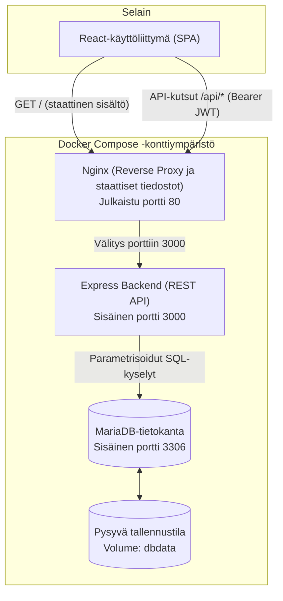

# JobTrack

## 1. Johdanto ja sovelluksen kuvaus

JobTrack on työnhaun seurantasovellus, jonka toteutan Web-sovelluskehitys -opintojakson harjoitustyönä. Sovelluksen avulla voi tallentaa kiinnostavia työpaikkoja ja seurata omien hakemustensa etenemistä keskitetysti yhdessä paikassa.

Tavoitteena on oppia rakentamaan kontitettu web-sovellus sekä ymmärtää käyttöliittymän, palvelimen ja relaatiotietokannan yhteistyö ja tietoturvan perusteet.

### Keskeiset toteutetut ominaisuudet:
- **Käyttäjähallinta**: Rekisteröityminen, sisäänkirjautuminen ja uloskirjautuminen suojattuina bcrypt-salasanatiivisteillä ja JWT-autentikoinnilla.
- **Käyttäjäkohtainen CRUD**: Omien työpaikkatietojen lisääminen, listaaminen, katselu, muokkaaminen ja poistaminen siten, että jokainen käyttäjä näkee vain omat tietonsa (IDOR-suojattu).
- **Käyttöliittymä ja välilehtinavigaatio**: Selkeä välilehtijako (`Omat työpaikat`, `Uusi työpaikka`, `Tuo ilmoituksia`), tiivis ja helppolukuinen taulukkonäkymä sekä erillinen katselumodaali tietojen avaamiseen ilman muokkaustilaan siirtymistä.
- **Suodatus ja järjestys**: Käyttöliittymän valinnat lähetetään backendille, joka suodattaa hakemuksen tilan mukaan ja järjestää prioriteetin tai uusimman tunnisteen mukaan (`id DESC`). Erillistä luontiaikakenttää ei ole.
- **Priorisointi ja osaamisen arviointi**: Työpaikan tärkeyden valinta (korkea, normaali, matala) ja valinnainen sopivuusluokka oman osaamisen vertailuun (vahva, osittainen, stretch).
- **JSON-tuonti**: Työpaikkailmoitusten erätuonti JSON-tiedostosta esikatselulla, syötteiden validoinnilla ja kaksoiskappaleiden automaattisella ohituksella.
- **Pysyvä tallennus ja kontitus**: Tiedot säilyvät MariaDB-volumessa, ja koko sovellus käynnistyy yhdellä Docker Compose -komennolla Nginx-käänteisvälityspalvelimen kautta.
- **Automaattinen laadunvalvonta**: Yksikkötestit, MariaDB-integraatiotestit sekä automatisoitu GitLab CI/CD -testipipeline.

### Hakujen priorisointi ja sopivuusluokat

Prioriteetti kertoo, mihin hakuihin halutaan panostaa ensin:
- **Korkea**, **normaali** (oletus) tai **matala**. Listan voi järjestää korkeasta prioriteetista matalaan.

Sopivuusluokka kuvaa omaa arviota osaamisen vastaavuudesta tehtävän vaatimuksiin:
- **Vahva vastaavuus**, **osittainen vastaavuus** tai **stretch**. Stretch tarkoittaa tehtävää, joka olisi selvä askel nykyistä osaamista vaativampaan rooliin. Luokan voi jättää tyhjäksi, jos ilmoitusta ei ole vielä arvioitu.

### Työpaikkojen JSON-tuonti

Sovellukseen voi tuoda työpaikkoja JSON-tiedostosta esimerkiksi tekoälypohjaisen työpaikkavahdin (esim. ChatGPT) löytämistä ilmoituksista. Tuontimuoto on JSON-olio, jonka ainoa kenttä on 1–20 työpaikkaa sisältävä `jobs`-taulukko. Tiedoston enimmäiskoko on 256 KiB.

1. Tallenna työpaikkavahdin antama sisältö UTF-8-koodattuun `.json`-tiedostoon. Suoraa ChatGPT-yhteyttä ei ole.
2. Valitse tiedosto **Tuo ilmoituksia (JSON)** -välilehdellä ja paina **Näytä esikatselu**.
3. Backend validoi tiedot ja tarkistaa kaksoiskappaleet. Esikatselu ei tallenna mitään.
4. Valitse haluamasi kelvolliset rivit ja paina **Tallenna valitut**.
5. Backend tarkistaa tiedot ja kaksoiskappaleet uudelleen sekä tallentaa uudet työpaikat samaan tietokantatransaktioon. Käyttöliittymä päivittää oman työpaikkalistan.

### JSON-mallipohja työpaikkavahdille

Seuraava pohja on kommentoitua JSONia (JSONC), jotta sallitut vaihtoehdot näkyvät suoraan kenttien vieressä. Anna pohja työpaikkavahdille ohjeeksi. Valitse kuhunkin luokituskenttään yksi sallittu arvo; `match_level` voi olla myös `null` ilman lainausmerkkejä.

Tallennettavan `tyopaikat.json`-tiedoston tulee sisältää tavallista JSONia: poista kaikki `//`-kommentit äläkä sisällytä tiedostoon Markdownia tai selitystekstiä. Esimerkin yritys ja osoite ovat kuvitteellisia.

```jsonc
{
  "jobs": [
    {
      "company": "Esimerkki Oy",
      "title": "Junior Full Stack Developer",
      "location": "Helsinki / hybridi",
      "url": "https://example.com/jobs/junior-developer",
      "deadline": "2026-11-30",
      "status": "interested", // Options: "interested", "applied", "interview", "offer", "rejected"
      "priority": "normal", // Options: "high", "normal", "low"
      "match_level": null, // Options: "strong", "partial", "stretch", null
      "notes": "React ja Node.js vastaavat osaamistani. MariaDB-osaamista kannattaa vahvistaa."
    }
  ]
}
```

| Kenttä | Sallitut arvot ja rajat |
| :--- | :--- |
| `company`, `title` | Pakollisia merkkijonoja, kumpikin 1–100 merkkiä |
| `url` | Tuonnissa pakollinen `http://`- tai `https://`-osoite, enintään 2048 merkkiä |
| `location` | Merkkijono, enintään 150 merkkiä, tai `null` |
| `deadline` | Todellinen päivämäärä `YYYY-MM-DD` (vuosi 1000–9999) tai `null` |
| `status` | `interested`, `applied`, `interview`, `offer`, `rejected`; puuttuessa `interested` |
| `priority` | `high`, `normal`, `low`; puuttuessa `normal` |
| `match_level` | `strong`, `partial`, `stretch` tai `null`; puuttuessa `null` |
| `notes` | Merkkijono, enintään 2000 merkkiä, tai `null` |

Työpaikkavahdille annettava ohje: käytä vain yllä olevia kenttiä ja englanninkielisiä luokitusarvoja. Älä lisää `id`- tai `user_id`-kenttiä. Merkitse tuntemattomat valinnaiset tiedot arvolla `null`; älä keksi puuttuvia tietoja. Jos yritys, tehtävänimike tai ilmoituksen osoite puuttuu, jätä ilmoitus pois erästä. Pilko yli 20 työpaikkaa erillisiin tiedostoihin.

Kaksoiskappale tunnistetaan saman käyttäjän täsmälleen samasta URL-osoitteesta reunavälilyöntien poistamisen jälkeen. Myös saman erän toistot ohitetaan. URL:n seurantaparametreja tai loppukauttaviivoja ei yhtenäistetä. Tuonti ei päivitä jo tallennettua työpaikkaa. Tavallisessa lisäyslomakkeessa URL on valinnainen, eikä CRUD-lisäys estä saman URL:n käyttöä.

---

## 2. Vaatimukset

Työ perustuu varsinaiseen Full Stack -harjoitustyön tehtävänantoon:

| Tehtävänannon vaatimus | Toteutus JobTrackissa | Tila |
| :--- | :--- | :--- |
| **React** | React 19 SPA, välilehtinavigaatio, lomake, tiivis taulukko, katselumodaali ja JSON-tuonti | Valmis |
| **Node.js / Express** | Node.js 24, Express 5 REST API, modulaarinen reititys, syötevalidointi ja virheenkäsittely | Valmis |
| **MariaDB** | MariaDB 11.8, käyttäjä- ja työpaikkataulut, InnoDB, viiteavaimet ja parametrisoidut kyselyt | Valmis |
| **Kirjautuminen** | Rekisteröityminen, bcrypt-salasanatiivisteet (salt rounds 10) ja JWT-autentikointi (HS256) | Valmis |
| **CRUD ja REST API** | Käyttäjäkohtainen työpaikkojen lisäys, haku, päivitys ja poisto | Valmis |
| **Dokumentaatio** | Kattava README: arkkitehtuuri, rajapinnat, tietomalli, asennus, testaus ja CI/CD | Valmis |
| **Testaus** | Automaattiset JWT-yksikkötestit, MariaDB-integraatiotestit, Oxlint ja Vite build | Valmis |
| **Docker & kontitus** | Docker Compose ja Dockerfilet (Nginx frontend/proxy, Node backend, MariaDB) | Valmis |
| **CI/CD** | `.gitlab-ci.yml`: frontendin lint/build ja backendin yksikkötestit | Määritelty; tarkista viimeisin pipeline GitLabissa |
| **GitLab-repositorio** | Projektilla on GitLab-origin ja Git-historia | Varmista viimeisten muutosten push ja opettajan oikeudet |
| **Esittely** | Lyhyt esittelyvideo sovelluksen toiminnoista | Varmista videon tallennus ja jaettu linkki |

---

## 3. Arkkitehtuuri

JobTrackin pääosat ovat selaimessa toimiva React-käyttöliittymä, Express-rajapinta ja MariaDB-tietokanta. Kontituksessa Nginx tarjoaa käyttöliittymän tiedostot ja välittää API-pyynnöt.



1. **Selain (Frontend)**: React SPA suoritetaan käyttäjän selaimessa. API-pyynnöt lähetetään suhteellisiin osoitteisiin `/api/*`.
2. **Nginx (Käänteissovitin ja tiedostopalvelin)**: Toimii sovelluksen ainoana ulospäin näkyvänä solmuna (portti 80). Tarjoaa valmiiksi käännetyt React-tiedostot ja välittää `/api/`-pyynnöt Express-palvelimelle. Tämä poistaa CORS-ongelmat, koska selaimelle kaikki liikenne tulee samasta alkuperästä (`origin`).
3. **Express (Backend REST API)**: Kuuntelee sisäisessä Docker-verkossa portissa 3000. Vastaa autentikoinnista, syötteiden tarkistuksesta ja liiketoimintalogiikasta.
4. **MariaDB (Tietokanta)**: Toimii omassa kontissaan samassa Compose-verkossa muiden palvelujen kanssa, portissa 3306. Koko sovelluksen Compose-asetus ei julkaise tietokannan porttia isäntäkoneelle. Tiedot tallennetaan nimettyyn Docker-volumeen (`dbdata`).

---

## 4. Frontend

Käyttöliittymä on toteutettu **React 19** -kirjastolla ja koottu **Vite 8** -työkalulla.

### Näkymät ja komponenttirakenne
Sovellus on responsiivinen Single Page Application (SPA), jossa näkymät on jaettu selkeisiin välilehtiin ilman ylimääräisiä reitityskirjastoja:
- **`App.jsx`**: Sovelluksen päätila ja koordinaattori. Hallitsee kirjautumisistuntoa (`session`), aktiivista välilehteä (`activeTab`), työpaikkalistaa, virheilmoituksia sekä ilmoitusbannereita.
- **`JobList.jsx`**: Työpaikkataulukko. Näyttää yrityksen, tehtävän, tilan, prioriteetin, sopivuuden ja hakuajan tiiviissä ja helppolukuisessa taulukossa. Taulukon riviä tai *Avaa*-painiketta klikkaamalla aukeaa **katselumodaali**, joka näyttää kaikki työpaikan lisätiedot (sijainnin, verkko-osoitteen ja muistiinpanot). Modaalista voi siirtyä suoraan muokkaukseen tai poistaa ilmoituksen.
- **`JobForm.jsx`**: Lomake työpaikan lisäämiseen ja muokkaamiseen. Tukee kenttien validointia, oletusarvoja ja peruutusta.
- **`JobImport.jsx`**: Työpaikkojen JSON-tiedoston valinta, esikatselu, rivikohtainen valinta ja tallennus.
- **`jobLabels.js`**: Suomenkieliset vakiotekstit hakemuksen tiloille, prioriteeteille ja sopivuusluokille.
- **`api.js`**: Keskitetty apufunktio `fetch`-pyynnöille. Liittää mukaan `Authorization: Bearer <token>` -otsakkeen, asettaa 10 sekunnin aikakatkaisun (`AbortSignal.timeout`) ja käsittelee virheet yhdenmukaisesti.
- **`index.css`**: Moderni, mukautettu ulkoasu CSS-muuttujilla, selkeillä väritageilla ja mobiiliresponsiivisuudella.

### Istunnonhallinta
Kirjautumistokenia säilytetään ainoastaan Reactin muistitilassa (`useState`). Tokenia ei kirjoiteta `localStorage`- tai `sessionStorage`-tilaan. Sivun uudelleenlataus vaatii uuden kirjautumisen. Muistitallennus ei yksin estä XSS-hyökkäyksiä. Uloskirjautuminen tyhjentää selaimen istunnon; jo myönnetty token on palvelimella kelvollinen vanhenemiseensa asti.

---

## 5. Backend

Taustajärjestelmä on toteutettu **Node.js 24**- ja **Express 5** -teknologioilla.

### Kerrosrakenne ja moduulit
Backend noudattaa selkeää modulaarista kerrosrakennetta:
- **`server.js`**: Palvelimen käynnistys ja portin kuuntelu.
- **`app.js`**: Express-sovelluksen konfigurointi, JSON-rungon lukeminen (kokorajoituksilla), reittien liittäminen ja keskitetty virheenkäsittely.
- **`auth.js`**: JWT-tokenien luonti ja `requireAuth`-middleware, joka varmentaa allekirjoituksen (HS256), vanhenemisajan ja käyttäjätunnisteen.
- **`db.js`**: `mysql2/promise`-yhteyspooli MariaDB-tietokantaan.
- **`jobValidation.js`**: Työpaikkatietojen ja hakukyselyparametrien kattava validointilogiikka.
- **`jobImport.js`**: JSON-erätuonnin validointi, esikatselutulokset ja URL-kaksoiskappaleiden tunnistus.
- **`routes/`**:
  - `authRoutes.js`: `/api/auth/register`, `/api/auth/login` ja `/api/auth/me`.
  - `jobRoutes.js`: `/api/jobs` CRUD-toiminnot käyttäjäkohtaisella rajauksella.
  - `jobImportRoutes.js`: `/api/job-import/preview` ja `/api/job-import/save`, tietokantatransaktio ja saman käyttäjän rinnakkaisten tuontien lukitus.

SQL-kyselyiden syötearvot välitetään parametreina. Järjestyskyselyn SQL-osat valitaan palvelimen ennalta määrittelemistä vaihtoehdoista; käyttäjän syötettä ei liitetä suoraan SQL-lauseeseen.

---

## 6. REST API

Kaikki suojatut reitit vaativat otsakkeen `Authorization: Bearer <token>`.

### Autentikointirajapinnat

| Metodi ja polku | Kuvaus | Statuskoodit |
| :--- | :--- | :--- |
| `POST /api/auth/register` | Rekisteröi uuden käyttäjän (`username`, `password`) | `201 Created`, `400 Bad Request`, `409 Conflict` |
| `POST /api/auth/login` | Kirjaa käyttäjän sisään, palauttaa JWT-tokenin | `200 OK`, `400 Bad Request`, `401 Unauthorized` |
| `GET /api/auth/me` | Palauttaa kirjautuneen käyttäjän julkiset tiedot | `200 OK`, `401 Unauthorized` |

### Työpaikkojen CRUD-rajapinnat

| Metodi ja polku | Kuvaus | Statuskoodit |
| :--- | :--- | :--- |
| `GET /api/jobs` | Listaa omat työpaikat (tukee parametreja `?status=` ja `?sort=`) | `200 OK`, `400 Bad Request`, `401 Unauthorized` |
| `POST /api/jobs` | Lisää uuden työpaikan kirjautuneelle käyttäjälle | `201 Created`, `400 Bad Request`, `401 Unauthorized` |
| `GET /api/jobs/:id` | Hakee yksittäisen oman työpaikan tiedot | `200 OK`, `400 Bad Request`, `401 Unauthorized`, `404 Not Found` |
| `PUT /api/jobs/:id` | Päivittää oman työpaikan tiedot | `200 OK`, `400 Bad Request`, `401`, `404 Not Found` |
| `DELETE /api/jobs/:id` | Poistaa oman työpaikan | `200 OK`, `400 Bad Request`, `401 Unauthorized`, `404 Not Found` |

### JSON-erätuonnin rajapinnat

| Metodi ja polku | Kuvaus | Statuskoodit |
| :--- | :--- | :--- |
| `POST /api/job-import/preview` | Validoi JSON-erän ja tarkistaa duplikaatit (max 20 työpaikkaa, 256 KiB) | `200 OK`, `400 Bad Request`, `401 Unauthorized` |
| `POST /api/job-import/save` | Tallentaa valitut työpaikat samassa transaktiossa; pelkät kaksoiskappaleet ohitetaan | `201 Created`, `200 OK` (kaikki ohitettu), `400 Bad Request`, `401 Unauthorized` |

`POST /api/jobs` ja `PUT /api/jobs/:id` vastaanottavat yhden työpaikkaolion JSON-mallin kentillä. PUT korvaa kaikki muokattavat tiedot: pois jätetyt valinnaiset kentät palautuvat oletusarvoihin tai `null`-arvoon. `sort` hyväksyy arvot `newest` (oletus) ja `priority`; `status` hyväksyy JSON-mallin tilat. Ilman `status`-parametria haetaan kaikki omat työpaikat.

Tuonnin esikatselu palauttaa `summary`-yhteenvedon ja `rows`-taulukon, jonka rivit ovat `ready`, `invalid` tai `duplicate`. Rivikohtaiset virheet voivat siis tulla `200 OK` -vastauksessa. Tallennus hylkää koko valinnan (`400`), jos yksikin valittu rivi on virheellinen.

Virheellinen JSON palauttaa `400`, liian suuri pyyntörunko `413` ja odottamaton palvelinvirhe `500`. Nämä yhteiset virheet koskevat myös tuontireittejä. Julkinen `GET /api/health` palauttaa `200` ja `{"status":"ok"}`; se ei tarkista tietokantayhteyttä.

---

## 7. Tietokanta ja tietomalli

Sovelluksen tietokantana on **MariaDB 11.8**. Tietokanta käyttää InnoDB-tallennusmoottoria ja `utf8mb4`-merkistöä.

```mermaid
erDiagram
    users ||--o{ jobs : "omistaa"

    users {
        int id PK
        string username UK
        string password_hash
    }

    jobs {
        int id PK
        int user_id FK
        string company
        string title
        string location
        string url
        date deadline
        string status
        string priority
        string match_level
        string notes
    }
```



### Taulujen kuvaukset
- **`users`**:
  - `id`: Pääavain (`INT UNSIGNED AUTO_INCREMENT`).
  - `username`: Käyttäjätunnus (`VARCHAR(30) UNIQUE`, 3–30 merkkiä).
  - `password_hash`: Bcrypt-tiiviste (`VARCHAR(255)`).
- **`jobs`**:
  - `id`: Pääavain (`INT UNSIGNED AUTO_INCREMENT`).
  - `user_id`: Viiteavain käyttäjään (`INT UNSIGNED NOT NULL`, viittaa `users(id)`).
  - `company` & `title`: Pakolliset merkkijonot (`VARCHAR(100)`).
  - `location`: Sijainti (`VARCHAR(150)`).
  - `url`: Ilmoituksen linkki (`VARCHAR(2048)`).
  - `deadline`: Hakuaika ilman aikavyöhykemuunnoksia (`DATE`).
  - `status`: ENUM (`'interested'`, `'applied'`, `'interview'`, `'offer'`, `'rejected'`).
  - `priority`: ENUM (`'low'`, `'normal'`, `'high'`).
  - `match_level`: ENUM (`'strong'`, `'partial'`, `'stretch'`, voi olla `NULL`).
  - `notes`: Omat muistiinpanot (`TEXT`); rajapinnan enimmäispituus 2000 merkkiä.

Viiteavain `FOREIGN KEY (user_id) REFERENCES users(id)` varmistaa referenssien eheyden.

---

## 8. Tietoturva

- **Salasanojen suojaus**: Salasanat tiivistetään `bcryptjs`-kirjastolla käyttäen satunnaista suolaa ja kustannuskerrointa 10. Selkokielisiä salasanoja tai tiivisteitä ei koskaan palauteta rajapinnoista.
- **JWT-autentikointi**: Tokenit allekirjoitetaan 256-bittisellä avaimella käyttäen HS256-algoritmia. Allekirjoitus, algoritmi, vanhenemisaika ja käyttäjätunniste tarkistetaan suojatuilla reiteillä. Oletusvoimassaolo on 3600 sekuntia.
- **IDOR-suojaus (Insecure Direct Object Reference)**: Kaikki työpaikkakyselyt rajataan SQL-tasolla kirjautuneen käyttäjän tunnisteeseen (`WHERE id = ? AND user_id = ?`). Toisen käyttäjän resursseihin ei pääse käsiksi edes arvaamalla tunnisteita.
- **SQL-injektiot**: Kaikki tietokantakyselyt käyttävät parametrisoituja kyselyjä (`pool.execute('... WHERE id = ?', [id])`).
- **Syötteiden validointi**: Syötteet validoidaan sekä selaimessa että itsenäisesti palvelimella. Pyynnöille on asetettu tiukat kokorajat (yleiset pyynnöt 16 KiB, tuontipyyntö 256 KiB).
- **Ympäristömuuttujat ja salaisuudet**: Salaisuuksia (`JWT_SECRET`, tietokantasalasanat) säilytetään vain paikallisissa `.env`-tiedostoissa, jotka on suljettu pois Gitistä ja Docker-kuvista.
- **CORS**: Selain käyttää samaa alkuperää sekä käyttöliittymälle että API-pyynnöille. Kontituksessa välityksen hoitaa Nginx ja paikallisessa kehityksessä Viten proxy. Erillisiä CORS-avauksia ei tarvita.

Nykyinen käyttöönotto on paikallinen HTTP-sovellus (`127.0.0.1`). Julkista palvelua varten tarvittaisiin muun muassa HTTPS ja kirjautumisyritysten rajoitus. Näitä ei ole toteutettu.

---

## 9. Testaus

Projektissa on automaattiset yksikkötestit, MariaDB-integraatiotestit sekä frontendin lint- ja build-tarkistukset. Aja tämän luvun komennot projektin juuresta. Riippuvuuksien on oltava asennettuina luvun 10 mukaisesti.

### 1. Automaattiset yksikkötestit (Node.js test runner)
Testaa JWT-tokenien luomisen, allekirjoituksen, vanhenemisen, virheelliset avaimet ja `requireAuth`-suojauksen:
```sh
npm --prefix backend test
```
Tarkistuksessa 11.10.2026 läpäistiin 9/9 testiä.

### 2. Automaattiset integraatiotestit (MariaDB-testikanta)
Testaa autentikoinnin ja työpaikkojen CRUD-toiminnot, käyttäjien tietojen eristyksen, syötevalidoinnit ja JSON-tuonnin oikeaa MariaDB-kantaa vasten. Tuontitesteissä tarkistetaan myös esikatselun tallentamattomuus, toistuva tuonti ja rinnakkaiset tuonnit.

Luo ensimmäisellä kerralla `.env.test` mallista. Säilytä `NODE_ENV=test`, `DB_NAME=jobtrack_test`, `DB_USER=jobtrack_test` ja erillinen portti `3307`. Täytä testikannalle omat salaisuudet luvun 10 ohjeella. Testit luovat omat testitietonsa ja poistavat ne ajon lopuksi.

```sh
cp -n .env.test.example .env.test
```

Kun asetukset ovat valmiit:
```sh
# Käynnistä testitietokanta
docker compose --env-file .env.test -f docker-compose.test.yml up -d --wait

# Aja integraatiotestit
npm --prefix backend run test:integration
```
Tarkistuksessa 11.10.2026 läpäistiin 2/2 integraatiotestikokonaisuutta. Kumpikin sisältää useita API-pyyntöjä ja tarkistuksia. Testikannan tiedot ovat tilapäisessä `tmpfs`-tallennuksessa.

### 3. Frontendin laadunvarmistus ja build
```sh
npm --prefix frontend run lint
npm --prefix frontend run build
```

Tarkistuksessa 11.10.2026 lint palautti 0 virhettä ja 0 varoitusta, ja build onnistui `node:20-alpine`-kontissa. Lähdekoodi oli vain luettavana, joten build kirjoitettiin kontin tilapäishakemistoon ja Viten asetukset ladattiin `--configLoader runner` -valinnalla. Paikallinen ajo pysähtyi puuttuviin Linux glibc -natiiviriippuvuuksiin: asennetussa `node_modules`-hakemistossa olivat Alpinen musl-versiot.

Frontendin automaattiset tarkistukset kattavat staattisen koodintarkistuksen ja tuotantoversion koostamisen. Käyttöliittymän toiminnallinen testaus tehdään käsin selaimessa. Testattavia toimintoja ovat rekisteröityminen, kirjautuminen, työpaikkojen CRUD-toiminnot, suodatus, katselumodaali, JSON-tuonti ja uloskirjautuminen. Virhetilanteiden tarkasteluun kuuluvat virheellinen JSON, toistuva tuonti ja käyttäjien tietojen erillisyys. Automaattisia frontendin komponentti- tai selaintestejä ei ole toteutettu.

### 4. Rajapinnan terveystarkistus
```sh
curl -i http://localhost/api/health
# Palauttaa 200 OK ja {"status":"ok"}
```

---

## 10. Asennus ja käynnistäminen

### Tarvittavat ohjelmistot
- **Git**
- **Docker** ja **Docker Compose**
- **Node.js 24** ja **npm** (paikallista kehitystä, testejä ja alla olevaa salaisuuksien luontikomentoa varten)

### 1. Projektin kloonaus
```sh
git clone https://gitlab.dclabra.fi/akiharju/webdev-harjoitustyo-akiharju.git
cd webdev-harjoitustyo-akiharju
```

Yksityisen repositorion kloonaaminen vaatii GitLab-käyttöoikeuden ja palvelimen hyväksymän tunnistautumistavan.

### 2. Ympäristömuuttujien asettaminen
Luo ensimmäisellä kerralla paikallinen `.env`-tiedosto mallipohjasta. `-n` säilyttää mahdollisen olemassa olevan tiedoston:
```sh
cp -n .env.example .env
```
Seuraava komento täyttää tyhjät `DB_ROOT_PASSWORD`-, `DB_PASSWORD`- ja `JWT_SECRET`-kentät erillisillä satunnaisilla arvoilla. Se säilyttää olemassa olevat arvot eikä tulosta salaisuuksia. Aja komento projektin juuresta. Testiympäristöä varten vaihda komennon `.env` arvoksi `.env.test`:
```sh
node --input-type=commonjs - .env <<'NODE'
const fs = require('node:fs');
const crypto = require('node:crypto');
const path = process.argv[2];
let content = fs.readFileSync(path, 'utf8');

// Fill only empty secret fields and keep existing values unchanged.
for (const key of ['DB_ROOT_PASSWORD', 'DB_PASSWORD', 'JWT_SECRET']) {
  content = content.replace(
    new RegExp(`^${key}=[ \\t]*$`, 'm'),
    () => `${key}=${crypto.randomBytes(32).toString('hex')}`,
  );
}

fs.writeFileSync(path, content);
console.log('Tyhjät salaisuuskentät täytetty.');
NODE
```

Älä lisää `.env`- tai `.env.test`-tiedostoja Gitiin. Tietokannan ympäristömuuttujat alustavat tunnukset vain tyhjään volumeen; olemassa olevan kannan salasana ei vaihdu pelkkää `.env`-tiedostoa muokkaamalla.

Jos haluat käyttää koko sovellusta konteissa, siirry tämän jälkeen lukuun 11. Paikallinen kehitys on vaihtoehtoinen käynnistystapa.

### 3. Paikallinen kehityskäynnistys (ilman tuotantokontitusta)

Aja seuraavat komennot projektin juuresta. Jos koko sovelluksen kontit ovat käytössä, pysäytä ne ensin komennolla `docker compose down`. Älä lisää `-v`-valintaa: kehitys ja koko sovellus käyttävät samaa `dbdata`-volumea.

1. Käynnistä kehitystietokanta:
   ```sh
   docker compose -f docker-compose.dev.yml up -d --wait
   ```
2. Luo taulut kehityskantaan. Kehityksen Compose-tiedosto ei aja alustusskriptiä automaattisesti. Komento luo puuttuvat taulut, mutta ei päivitä olemassa olevien taulujen rakennetta:
   ```sh
   docker compose -f docker-compose.dev.yml exec -T db sh -c \
     'MYSQL_PWD="$MARIADB_PASSWORD" exec mariadb --user="$MARIADB_USER" "$MARIADB_DATABASE"' \
     < backend/schema.sql
   ```
3. Asenna backendin riippuvuudet, tarkista tietokantayhteys ja käynnistä backend:
   ```sh
   npm --prefix backend ci
   npm --prefix backend run db:check
   npm --prefix backend run dev
   ```
4. Käynnistä frontend toisessa terminaalissa projektin juuresta:
   ```sh
   cp -n frontend/.env.example frontend/.env
   npm --prefix frontend ci
   npm --prefix frontend run dev
   ```
   Avaa kehitysversio selaimessa osoitteessa `http://localhost:5173`.

Älä jaa `node_modules`-hakemistoa Alpinen ja tavallisen Linuxin välillä. Jos lint tai build ilmoittaa puuttuvasta `@oxlint/binding-*`- tai `@rolldown/binding-*`-paketista, aja `npm --prefix frontend ci` siinä ympäristössä, jossa aiot käyttää työkaluja. Säilytä `package-lock.json`.

---

## 11. Docker ja käyttöönotto

Koko sovellus voidaan käynnistää tuotantoympäristöä vastaavana monikonttiratkaisuna yhdellä komennolla.

### Palvelut ja kontit
- **`frontend`**: Monivaiheinen Dockerfile, joka kääntää React-sovelluksen ja tarjoaa sen Nginxillä (Alpine). Kuuntelee isäntäkoneen porttia 80.
- **`backend`**: Node.js 24 -kontti, joka suorittaa Express REST API:a sisäisessä verkossa (portti 3000) ilman root-oikeuksia.
- **`db`**: MariaDB 11.8 -kontti sisäisessä verkossa (portti 3306), tiedot talletetaan `dbdata`-volumeen. Alustaa taulut tiedostosta `backend/schema.sql` vain tyhjään tietokantavolumeen.

### Konttien käynnistäminen

Aja projektin juuresta, kun `.env` on täytetty. Jos kehitystietokanta on käynnissä, pysäytä kehityskokoonpano ensin komennolla `docker compose -f docker-compose.dev.yml down` ilman `-v`-valintaa.

```sh
docker compose up -d --build --wait
```
Kun komento valmistuu onnistuneesti, sovellus on käytettävissä oletusasetuksilla osoitteessa **`http://localhost`**. Luo oma käyttäjätili kirjautumisnäkymästä; esiasennettua käyttäjätunnusta ei ole. `WEB_HOST` ja `WEB_PORT` määrittävät julkaistavan osoitteen ja portin. Aja build-komento uudelleen lähdekoodimuutosten jälkeen.

### Konttien tarkistaminen ja hallinta
```sh
# Tarkista konttien tilat ja terveystarkistukset
docker compose ps

# Tarkista tietokantayhteys backendistä käsin
docker compose exec backend node check-db.js

# Tarkista Nginxin konfiguraatio
docker compose exec frontend nginx -t

# Pysäytä sovellus säilyttäen tietokannan tiedot
docker compose stop

# Sammuta kontit
docker compose down
```

---

## 12. CI/CD

Tiedosto `.gitlab-ci.yml` määrittelee GitLab-pipelinen, jossa on yksi vaihe (`test`) ja kaksi rinnakkain ajettavaa työtä. Suoritus tarvitsee käytettävissä olevan GitLab Runnerin, jolla on `docker`-tagi.

| Työ | Ympäristö | Komennot |
| :--- | :--- | :--- |
| `frontend-check` | `node:20-alpine` | `cd frontend`, `npm ci`, `npm run lint`, `npm run build` |
| `backend-unit-tests` | `node:20-alpine` | `cd backend`, `npm ci`, `npm test` |

Pipelineen ei sisälly MariaDB-integraatiotestejä, Docker-imagejen rakentamista tai julkaisemista eikä automaattista deployta. Integraatiotestit ajetaan erikseen luvun 9 mukaan, ja Docker-build sekä käynnistys luvun 11 mukaan.

Paikalliset tarkistukset eivät vahvista GitLab-pipelinen tilaa. Varmista viimeisen pushin jälkeen GitLabissa, että molemmat työt ovat onnistuneet, ja liitä halutessasi palautukseen linkki onnistuneeseen pipelineen.

---

## 13. Projektin kansiorakenne

```text
├── backend/
│   ├── routes/
│   │   ├── authRoutes.js           # Rekisteröinti, kirjautuminen ja käyttäjätiedot
│   │   ├── jobRoutes.js            # Työpaikkojen käyttäjäkohtaiset CRUD-reitit
│   │   └── jobImportRoutes.js      # Työpaikkojen JSON-tuonti ja esikatselu
│   ├── test/
│   │   ├── auth.test.js            # Automaattiset JWT- ja autentikointitestit
│   │   ├── authRoutes.integration.js # Autentikoinnin MariaDB-integraatiotesti
│   │   └── jobs.integration.js     # Työpaikkojen MariaDB-integraatiotesti
│   ├── app.js                      # Express-sovellus ja virheenkäsittely
│   ├── server.js                   # HTTP-palvelimen käynnistys
│   ├── auth.js                     # JWT-tokenien luonti ja requireAuth-middleware
│   ├── db.js                       # MariaDB-yhteyspooli
│   ├── check-db.js                 # Tietokantayhteyden tarkistusskripti
│   ├── schema.sql                  # MariaDB-taulujen luontiskripti
│   ├── jobValidation.js            # Työpaikkojen ja parametrien validointi
│   ├── jobImport.js                # JSON-tuonnin validointi ja säännöt
│   ├── Dockerfile                  # Backendin konttikuva
│   └── .dockerignore               # Tiedostot, joita ei viedä konttiin
├── frontend/
│   ├── src/
│   │   ├── App.jsx                 # Päätila, istunto ja välilehtinavigaatio
│   │   ├── JobList.jsx             # Työpaikkataulukko ja tietojen katselumodaali
│   │   ├── JobForm.jsx             # Työpaikan lisäys- ja muokkauslomake
│   │   ├── JobImport.jsx           # JSON-tuonnin käyttöliittymä ja esikatselu
│   │   ├── jobLabels.js            # Suomenkieliset vakiotekstit
│   │   ├── api.js                  # Keskitetty fetch-apufunktio Bearer-tokenilla
│   │   └── index.css               # Sovelluksen tyylit ja responsiivisuus
│   ├── nginx.conf.template         # Nginxin asetuspohja ja API-käänteissovitin
│   ├── Dockerfile                  # Frontendin ja Nginxin monivaiheinen konttikuva
│   └── vite.config.js              # Viten asetukset ja kehitysproxy
├── docker-compose.yml              # Koko sovelluksen monikonttikäynnistys
├── docker-compose.dev.yml          # Kehityksen paikallinen tietokanta
├── docker-compose.test.yml         # Eristetty testitietokanta integraatiotesteille
├── .env.example                    # Ympäristömuuttujien mallipohja
├── .env.test.example               # Testiympäristön mallipohja
├── .gitlab-ci.yml                  # GitLab CI/CD -automaatiopipeline
├── AGENTS.md                       # Koodausavustimen työskentelyohjeet
└── README.md                       # Projektin kattava dokumentaatio
```

---

## 14. Yhteenveto ja jatkokehitys

### Mitä projektissa toteutettiin
- Täysi Full Stack -kokonaisuus: React 19, Node.js 24 / Express 5, MariaDB 11.8 ja Nginx.
- Turvallinen käyttäjähallinta (bcrypt + JWT) ja käyttäjäkohtainen tietojen eristys.
- Täydet CRUD-toiminnot työpaikoille suodatuksella ja priorisoinnilla.
- Työpaikkojen JSON-erätuonti esikatselulla ja kaksoiskappaleiden estolla.
- Moderni ja selkeä välilehtipohjainen käyttöliittymä katselumodaalilla.
- Täysi Docker Compose -kontitus Nginx-käänteisvälityspalvelimella.
- Automaattitestit ja automatisoitu GitLab CI/CD -pipeline.

### Mitä jäi toteuttamatta / Jatkokehityskohteet
- Suora automaattinen integraatio tekoälypalveluun (esim. OpenAI API) työpaikkojen automaattiseen skannaukseen.
- Frontendin selaintasoiset End-to-End -automaatiotestit (esim. Playwright tai Cypress).
- Sähköpostipohjainen salasanan palautus.
- Julkisen tuotantopalvelimen automaattiset Let's Encrypt HTTPS -sertifikaatit.

---
